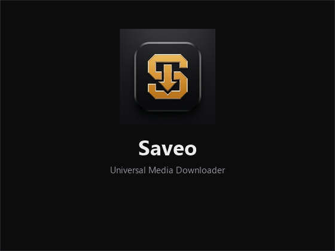

## Your media. Your quality. Your library

*A local-first video, audio, and social media downloader for Windows, with an experimental Android edition.*

*Download Videos, Reels, Shorts, playlists, albums, and audio from YouTube, Instagram, TikTok, Facebook, Reddit, X, Bilibili, and 1,000+ supported media sites at full quality — with live progress and speed tracking.*

[-0078d4.svg?style=flat-square&logo=windows)](https://github.com/ProTechPh/Saveo/releases)

[**Get Saveo**](#get-saveo) · [**Explore Features**](#built-for-your-downloads) · [**Supported Sources**](#where-saveo-works) · [**How to Use**](#using-saveo)

---

## ✧ Why Saveo?

Media downloads shouldn't require juggling browser tabs, managing scattered files, or guessing how long a download will take.

Saveo brings media extraction, quality selection, download management, and file organization into one interface. Paste a supported link, inspect the available media, choose your preferred format, and follow the download from start to finish.

- **Choose your format:** Select available video resolutions or extract audio in supported formats.
- **Keep collections organized:** Download playlists and albums into dedicated folders.
- **Handle multiple links:** Queue multiple URLs and track their progress together.
- **See every download in motion:** Monitor progress, speed, downloaded size, and estimated time remaining.
- **Make it yours:** Customize download preferences, choose a theme, and revisit your local download history.
- **Keep control local:** Download operations run on your device without built-in analytics or third-party proxy routing.

---

## ✦ Built for your downloads

<table>
<tr>
<td width="50%" valign="top">

### 🎬 Video & Audio

Select from available resolutions, including 4K/2160p, 2K/1440p, 1080p, 720p, 480p, 360p where supported. Choose the best available format or inspect available containers and estimated file sizes.

Extract audio as MP3 at up to 320 kbps, Apple AAC in M4A, or WAV where supported.

</td>
<td width="50%" valign="top">

### 📚 Playlists & Albums

Detect supported playlist and album URLs, inspect the available item count, and organize downloads into a dedicated folder named after the playlist.

Keep related media together instead of scattering individual files across your download directory.

</td>
</tr>
<tr>
<td width="50%" valign="top">

### ⚡ Live Download Tracking

Follow downloads with a live progress bar, speed in MB/s, downloaded file size, and a dynamically updated estimated time of arrival (ETA).

A breathing local services indicator also displays real-time engine connectivity and status.

</td>
<td width="50%" valign="top">

### 📥 Batch Queue

Add multiple URLs on separate lines or separated by commas. Saveo parses valid links, applies global presets, and displays queue counters with live progress feedback.

</td>
</tr>
<tr>
<td width="50%" valign="top">

### 🗂️ Local Library & History

Review past downloads, play completed files, open their containing folders, or clear your download history.

Filename sanitization preserves original media titles while removing reserved filesystem characters and helping prevent accidental file overwrites.

</td>
<td width="50%" valign="top">

### ⚡ Instant Splash & Fast Boot

Instant ~50ms visual feedback on launch with Saveo's glowing droplet emblem splash window, paired with dynamic real-time engine startup progress tracking (*"Starting engine..."*) and background prewarming so you jump straight to the download interface.

</td>
</tr>
<tr>
<td width="50%" valign="top">

### 🍪 Bot Challenge Bypass

Integrated authentication manager supports browser session extraction (Firefox, Brave, Vivaldi, Chrome, Edge) or importing Netscape `cookies.txt` to bypass YouTube *"Sign in to confirm you're not a bot"* challenges.

</td>
<td width="50%" valign="top">

### 🌐 Regional Network Resilience

Smart error detection identifies country-level ISP blocks and geo-restrictions, providing actionable guidance for seamless downloads with VPNs like Cloudflare WARP or ProtonVPN.

</td>
</tr>
</table>

  

### More built in

- **Duplicate-aware downloads:** Saveo can skip a link that was already completed in the same format, with a one-click “download another copy” override.
- **Restart-safe queue:** Queued and paused downloads are saved locally and resume from their partial file after relaunch.
- **Bulk queue controls:** Pause all, resume all, and retry failed downloads from the queue header.
- **Library actions:** Re-download a previous item in its original format, or delete the file from disk.
- **Network controls:** Optional bandwidth limit and parallel-fragment downloads for faster or metered connections.
- **Drag-and-drop links:** Drop one link into the input, or a list of links into the batch drawer.
- **In-app updates:** Check for new Saveo releases and view release notes directly inside the application.
- **Engine maintenance:** Update the embedded yt-dlp core engine from within the application with a single click.
- **Dynamic version synchronization:** Keeps the displayed application version synchronized with release tags.
- **Flexible download settings:** Customize default download directory, quality presets, and concurrent-connection preferences.
- **Local-first execution:** No built-in telemetry, analytics, or external tracking.

---

## ⬇️ Get Saveo

Saveo provides pre-compiled packages for Windows and Android. Development tools and a separate Python installation are not required for the packaged releases.

### 🪟 Windows — Stable

*The primary Saveo experience, powered by the full Windows download engine.*

| Package | Format | Download (Latest) | Latest Mirror |
| :--- | :--- | :--- | :--- |
| **Saveo Setup** *(Recommended)* | `.exe` Modern Installer | [**Download Saveo-Setup.exe**](https://github.com/ProTechPh/Saveo/releases/latest/download/Saveo-Setup.exe) | [Latest Installer Mirror](https://github.com/ProTechPh/Saveo/releases/latest/download/Saveo-Setup.exe) |
| **Saveo Portable** | Standalone `.zip` | [**Download Saveo-Windows-x64.zip**](https://github.com/ProTechPh/Saveo/releases/latest/download/Saveo-Windows-x64.zip) | [Latest ZIP Mirror](https://github.com/ProTechPh/Saveo/releases/latest/download/Saveo-Windows-x64.zip) |

#### Install or launch

- **A. Setup Installer:**
  1. Download **`Saveo-Setup.exe`**.
  2. Run the installer and follow the prompts. Saveo installs into your user profile without requiring administrator prompts.
  3. Launch from the Start Menu, Windows Search, or desktop shortcut. Supports clean, seamless updates.
- **B. Portable Archive:**
  1. Download **`Saveo-Windows-x64.zip`**.
  2. Extract the archive to your preferred folder.
  3. Run **`Saveo.exe`**. No installation required—runs from any folder or USB drive.

#### Windows compatibility

| Requirement | Details |
| :--- | :--- |
| **Operating system** | Windows 10, version 1809 or later, or Windows 11 |
| **Architecture** | x86_64 |
| **Interface dependency** | Microsoft Edge WebView2 *(with automatic browser fallback)* |
| **Framework** | .NET Framework 4.5+ |
| **Media engine** | yt-dlp with bundled FFmpeg |
| **Media capabilities** | High-resolution stream merging, audio conversion, playlist folders |
| **Desktop integration** | Native taskbar integration & badges |
| **Testing note** | Tested on Windows 11 |

[Browse all Windows releases →](https://github.com/ProTechPh/Saveo/releases)

---

### 🤖 Android — Experimental

*An early mobile build for community testing and feedback. Android support is still being validated, particularly around storage locations, folder navigation, and batch queue behavior.*

| Package | Supported Architectures | Direct Package | Releases |
| :--- | :--- | :--- | :--- |
| **Saveo for Android** | `arm64-v8a`, `armeabi-v7a`, `x86_64` | [**Download Saveo-Android.apk**](https://github.com/ProTechPh/Saveo/releases/latest/download/Saveo-Android.apk) | [All Releases](https://github.com/ProTechPh/Saveo/releases) |

#### Installation

1. Download **`Saveo-Android.apk`** to your device.
2. Open the APK file. If prompted, allow installation using Android's *"Install unknown apps"* permission.
3. Launch Saveo from your app drawer.
4. To send a media link to Saveo, use the Android **Share** menu from a supported browser or social media app.

#### Android compatibility

| Requirement | Details |
| :--- | :--- |
| **Minimum operating system** | Android 7.0 Nougat, API 24+ |
| **Architectures** | `arm64-v8a`, `armeabi-v7a`, `x86_64` |
| **Interface dependency** | Android System WebView with native modern navigation |
| **Media engine** | Embedded Python 3.11 with yt-dlp core |
| **Current capabilities** | Adaptive resolutions (up to 4K / 1440p / 1080p where available) and standalone audio extraction |
| **Storage location** | Public `Download/Saveo` directory (accessible to Gallery and all media players) |
| **Preferences storage** | Persistent native Android `SharedPreferences` |
| **Status** | Active development; fully functional local downloads |

> [!NOTE]
> **Android Storage & Playback:**
> Downloads are saved directly into your device's public `Download/Saveo` folder. Tapping **Play / Open File** directly invokes your installed video or audio players (such as VLC, MX Player, or Google Photos), while **Open Containing Folder** navigates directly to your Saveo download directory.

---

## 🌐 Where Saveo works

Saveo uses yt-dlp to extract supported media across 1,000+ sites. Actual compatibility, available streams, and maximum quality depend on the source website and individual media link.

| Source | Supported media | Quality and behavior |
| :--- | :--- | :--- |
| **YouTube** | Videos, Shorts, music, playlists | Up to 4K UHD 60fps on Windows, with automatic high-bitrate video/audio stream merging |
| **Instagram** | Reels, Stories, posts, carousels | MP4 video clips and high-resolution images where available |
| **TikTok** | Video posts and audio clips | High-definition video streams without platform watermarks where supported |
| **X / Twitter** | Video tweets, clips, GIF loops | Best available progressive MP4 bitrate streams |
| **Facebook** | Public watch videos and Reels | High-definition and standard MP4 streams |
| **Reddit** | Hosted videos (`v.redd.it`) | Automatic video and audio track merging |
| **Bilibili** | Videos and animation clips | High-resolution streaming media |
| **Vimeo** | Showcase and portfolio videos | Adaptive MP4 streams |
| **SoundCloud** | Audio tracks and full albums | High-quality audio extraction |
| **Direct links** | `.mp4`, `.webm`, `.mp3`, `.wav` | Accelerated streaming chunk downloads |

---

## 🎯 Using Saveo

### 🪟 Windows Desktop Guide

#### 1. Single Media Download

1. **Copy a link:** Copy any media URL (YouTube, Instagram, TikTok, Reddit, X, Facebook, etc.).
2. **Paste & Analyze:** Paste into the input field or click **Paste**, then click **Analyze** (or press Enter).
3. **Select Quality:**
   - **Video Mode:** Select *Best Available (Auto)*, *4K UHD (2160p)*, *2K QHD (1440p)*, *Full HD (1080p)*, or *HD (720p)*.
   - **Audio Mode:** Choose *MP3 (320 kbps HQ)*, *M4A (Apple AAC)*, or *WAV (Lossless PCM)*.
4. **Download:** Click **Download** to monitor real-time speed (MB/s), downloaded bytes, and dynamic ETA.
5. **Access Media:** Click **Play File** to launch in your default media player, or **Open Containing Folder** to reveal the file in Windows Explorer.

#### 2. Playlists, Albums & Series

1. Paste a playlist or series link. Saveo parses all tracks and displays total duration and item count.
2. Choose your quality preset (4K, 2K, 1080p, 720p, 480p, Best Auto, or Audio). Estimated sizes accurately reflect combined stream bitrates.
3. Saveo automatically creates a dedicated subfolder named after the playlist in your download directory.

#### 3. Batch Downloads & Queue Management

1. Switch to the Downloader view and paste multiple URLs (one per line).
2. Apply a global quality preset and click download to process the queue.

---

### 🤖 Android Mobile Guide

#### 1. Quick Download & System Share Menu

- **Option A (In-App):** Open Saveo on Android, paste any link, and tap **Analyze**. Choose your quality tier and tap **Download**.
- **Option B (System Share):** In YouTube, Instagram, Twitter/X, or TikTok, tap **Share** and select **Saveo**. Saveo opens, auto-analyzes the media, and lets you download with a single tap.

#### 2. Dedicated Mobile Navigation

- Seamlessly switch between **Downloader**, **History**, and **Settings** using the modern Android bottom navigation bar.

#### 3. Media Player Launching & File Access

- **Play / Open File:** Exclusively queries installed media players (VLC, MX Player, Google Photos, BSPlayer).
- **Open Containing Folder:** Directly opens `Download/Saveo` in your device's file manager.

#### 4. Settings Persistence

- All preferences (theme, default format, notifications) persist across reloads and tab switches via native Android `SharedPreferences`.

#### 5. Bypassing YouTube Bot Verification

- Saveo on Android features **zero-configuration cookie auto-detection**.
- If YouTube challenges requests with *"Sign in to confirm you're not a bot"*, simply place a `cookies.txt` file into your phone's `Download/` or `Download/Saveo/` folder. Saveo detects and applies it automatically. [See step-by-step instructions below →](#bot-bypass-android)

---

## 🍪 Bypassing YouTube "Sign In to Confirm You're Not a Bot"

YouTube occasionally challenges anonymous requests from downloaders with anti-bot verification checks (`Sign in to confirm you're not a bot`). Saveo provides built-in solutions for both Windows and Android:

### 🪟 Windows Desktop Setup

#### Option 1 (Easiest) — Local Browser Session Extraction

1. Open **Settings** in Saveo.
2. Under **Browser Session Extraction**, select **Auto-Probe Installed Browsers** or choose your installed browser (e.g., **Firefox**, **Brave**, **Vivaldi**, **Edge**, or **Chrome**).
3. Saveo will automatically use your existing browser session to authenticate requests.

#### Option 2 (Persistent & Portable) — cookies.txt Import

1. In your browser (Chrome, Edge, or Firefox), install the extension **Get cookies.txt LOCALLY**.
2. Log into YouTube, click the extension icon, and export your cookies as `cookies.txt`.
3. In Saveo **Settings**, click **Browse...** or **Upload...** under **Persistent cookies.txt File** and select your file.
4. Your cookies are saved securely on your PC in `~/.saveo/cookies.txt` (or `%LOCALAPPDATA%\Saveo\cookies.txt`) and never transmitted anywhere else.

---

### 🤖 Android Setup (Zero-Config cookies.txt Auto-Detection)

On Android, Saveo automatically detects and authenticates using standard Netscape `cookies.txt` files placed on your device:

1. **Export cookies:**
   - **From Desktop:** In Chrome, Edge, or Firefox, install the extension **Get cookies.txt LOCALLY**, log into YouTube, and export your cookies as `cookies.txt`.
   - **From Mobile:** Use a mobile browser that supports extensions (such as **Kiwi Browser** or **Firefox for Android**), install **Get cookies.txt LOCALLY**, log into YouTube, and export `cookies.txt`.
2. **Place in Download Folder:**
   Move or save the exported `cookies.txt` into either of these locations on your device:
   - `/storage/emulated/0/Download/Saveo/cookies.txt` *(Recommended)*
   - `/storage/emulated/0/Download/cookies.txt`
3. **Automatic Detection (Zero Configuration):**
   Launch Saveo. The embedded download engine automatically locates and reads the `cookies.txt` file, seamlessly bypassing bot-verification challenges, age gates, and member-only restrictions without any manual configuration!

---

## 🌐 Regional Bans & VPN Advisory

> [!WARNING]
> **Platform Bans (e.g., TikTok in India, regional geo-blocks):**  
> If an online platform is banned or restricted by your country's government or Internet Service Providers (ISPs), connection attempts will silently time out (*"Connection timed out or was blocked by host/ISP"*).

To download media from banned or region-locked platforms:

- **Turn on a VPN** connected to an unrestricted region (e.g. **Cloudflare WARP**, **ProtonVPN**, or **Windscribe**).
- Or configure a system HTTP/SOCKS5 proxy before launching Saveo. Saveo will immediately route traffic through the active connection.

---

## ⚙️ Under the hood

Saveo combines a local interface with its media extraction engine and supporting tools:

| Component | Role |
| :--- | :--- |
| **yt-dlp** | Media metadata extraction, format discovery, and downloading |
| **FFmpeg** | Video/audio stream merging and audio conversion on Windows |
| **Embedded Python 3.11** | Part of the experimental Android media engine |
| **Microsoft Edge WebView2** | Windows interface dependency, with browser fallback when unavailable |
| **Android System WebView** | Android interface dependency |

---

## ⚖️ Privacy & responsible use

Saveo is an open-source utility designed for personal archival, educational, and authorized fair-use purposes.

### 🛡️ Security & Privacy Architecture

- **Localhost-Only Binding:** Backend server strictly binds to `127.0.0.1`, ignoring external network interfaces.
- **Dynamic Authentication Token:** All `/api/*` and WebSocket endpoints require a cryptographic `X-Auth-Token` generated at startup to prevent unauthorized local script or browser tab access.
- **Cross-Site Attack Protection:** Requests with external `Origin` headers or `Sec-Fetch-Site: cross-site` are blocked with `403 Forbidden`.
- **Command Injection Prevention:** File launch and directory inspection calls use `os.startfile()` and token-safe `explorer.exe` process arguments without shell expansion (`shell=False`).
- **Path Traversal Guards:** Strict containment checks ensure all disk operations and file retrieval requests are confined within user-authorized directories.
- **Input Bounding:** Hard limits on URL lengths (2048 chars), directory paths (1000 chars), and playlist items (500 items ceiling) protect system memory against denial-of-service abuse.
- **Zero Telemetry:** No third-party analytics, ads, or external cloud telemetry requests.

### Copyright and platform terms

Users are solely responsible for complying with applicable copyright laws and website Terms of Service. Saveo does not bypass DRM (Digital Rights Management), decrypt subscription-protected streams, or circumvent private authentication walls. Only download media you own or are authorized to access and save.

---

## 💬 Feedback & community

- 🐛 **Issues & feature requests:** [Open an issue on GitHub](https://github.com/ProTechPh/Saveo/issues)
- 🚀 **Releases & updates:** [Browse all Saveo releases](https://github.com/ProTechPh/Saveo/releases)
- 📂 **Source code:** [Explore the Saveo repository](https://github.com/ProTechPh/Saveo)

---

## 📄 License

Saveo is distributed under the [MIT License](LICENSE).

 

Made with care, a little curiosity, and a feline friend. 🐈  
**Yours Truly, Saveo**

